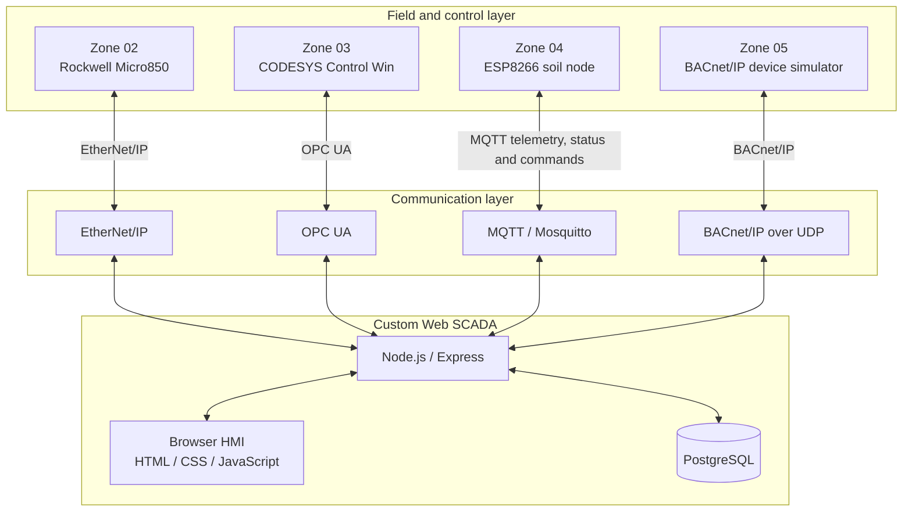
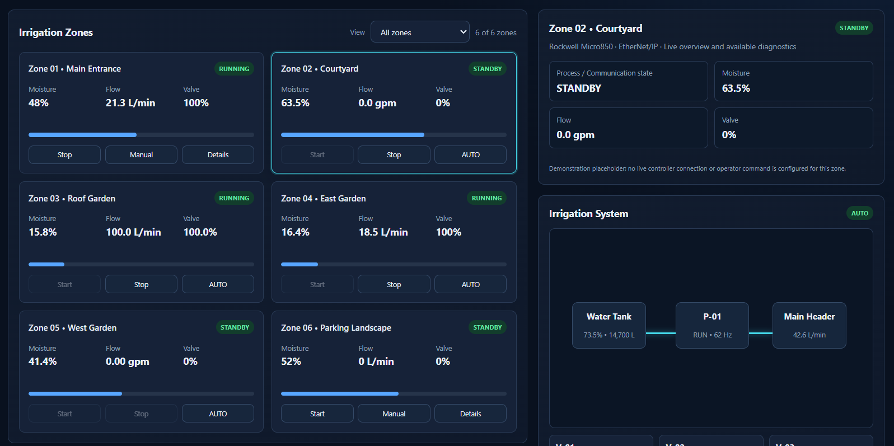
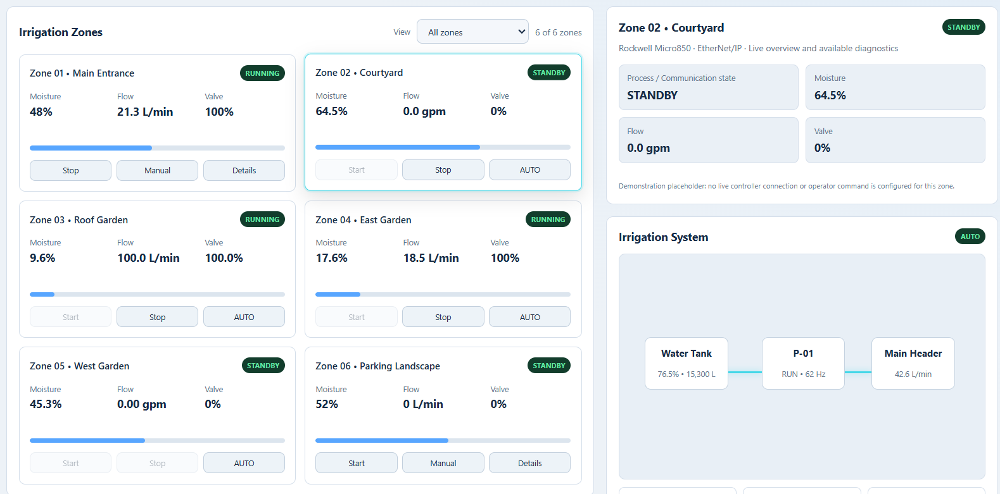

# Industrial Water Management — Web SCADA & HMI

A custom browser-based SCADA/HMI for an industrial water-management testbed. The project brings together different controller and edge technologies behind one web monitoring interface.

The current implementation demonstrates four zone integrations:

- **Zone 02 — Rockwell Micro850:** EtherNet/IP communication using a Node.js driver based on `st-ethernet-ip`.
- **Zone 03 — CODESYS:** OPC UA communication with a CODESYS Control Win runtime.
- **Zone 04 — IoT Edge:** ESP8266 telemetry and bidirectional mode commands over MQTT.
- **Zone 05 — BACnet/IP:** an independent irrigation-device simulator accessed by a dedicated Node.js BACnet client driver.

The web application uses **HTML, CSS and vanilla JavaScript** on the frontend, **Node.js and Express** on the backend, and **PostgreSQL** for equipment, tag configuration and historical readings.

This is an engineering testbed. It is intended to explore controller integration, protocol handling, data acquisition, operator interaction and IT/OT architecture. It is not presented as a production-ready or safety-certified control system.

## Project architecture



The backend acts as the integration layer between the controller-specific protocols and the browser HMI. The browser does not communicate directly with the PLCs.

## Zone implementation and status

| Zone | Technology | Integration | Current scope |
|---|---|---|---|
| Zone 02 | Rockwell Micro850 | EtherNet/IP | Live tag polling and whitelisted Boolean commands through the Node.js driver |
| Zone 03 | CODESYS Control Win | OPC UA | Live tag browsing and polling, operator commands and PLC-side process logic |
| Zone 04 | ESP8266 | MQTT | Soil-moisture telemetry, device status, AUTO/MANUAL commands and acknowledgements |
| Zone 05 | Simulated BACnet/IP device | BACnet/IP over UDP | Analog and binary process values, commandable Binary Outputs and process simulation |
| SCADA | Custom Web HMI | REST API | Unified monitoring, zone cards, operator controls and communication status |

The project also contains local process simulations. In particular, Zone 04 moisture telemetry is received from the ESP8266, while its valve command and flow indication remain simulated. The ESP8266 firmware's onboard LED indicates the selected firmware mode; it is not physical valve feedback.

## Technology stack

| Layer | Technologies |
|---|---|
| Frontend | HTML5, CSS3, vanilla JavaScript |
| Backend | Node.js, Express |
| Database | PostgreSQL |
| Zone 02 protocol | EtherNet/IP |
| Zone 03 protocol | OPC UA |
| Zone 04 protocol | MQTT |
| Zone 05 protocol | BACnet/IP |
| MQTT broker | Mosquitto |
| Edge device | ESP8266 / Wemos D1 |
| PLC environments | Rockwell CCW / Micro800 and CODESYS |

## Key capabilities

- Multi-brand integration through separate protocol-specific backend drivers.
- Zone 02 Micro850 polling and controlled Boolean writes.
- Zone 03 OPC UA tag discovery from the CODESYS `GVL_SCADA` variable group.
- Zone 03 command whitelist, pulse handling for edge-triggered commands and server-side interlock messages.
- Zone 04 MQTT telemetry ingestion directly by the Node.js backend.
- MQTT device status and command-result acknowledgement handling.
- UDP broker discovery for the Zone 04 ESP8266 on a shared IPv4 subnet.
- Shared PostgreSQL historian persistence for selected observations from Zones 02–05.
- Live data freshness handling, including `GOOD` and `UNCERTAIN` quality states.
- REST endpoints that separate the browser HMI from industrial protocol details.
- Zone 05 BACnet/IP polling, normalized observations and whitelisted AUTO/MANUAL/START/STOP/FAULT_RESET commands.

## Zone 02 — Rockwell Micro850

The Node.js driver is located at `server/drivers/micro800/zone02.js`.

- Uses the `st-ethernet-ip` library.
- Connects to the Micro850 using the configured PLC IP address.
- Polls configured Zone 02 tags at a one-second interval.
- Retries the connection after communication failure.
- Serializes PLC requests to avoid overlapping read and write operations.
- Uses a command whitelist. Start, Stop and Fault Reset are momentary pulse commands; Auto and Simulation Enable are level commands.
- Reads the permissive before accepting a Start command.

Default PLC address: `192.168.203.1`. Set `ZONE02_PLC_IP` to override it.

## Zone 03 — CODESYS and OPC UA

The backend connects to CODESYS Control Win through OPC UA at:

`opc.tcp://127.0.0.1:4840`

The OPC UA client browses the `GVL_SCADA` variable group and polls discovered variables every second. Zone 03 commands are restricted to a whitelist:

| HMI command | PLC variable | Handling |
|---|---|---|
| Start | `Z03_START` | 300 ms pulse |
| Stop | `Z03_STOP` | 300 ms pulse |
| Fault Reset | `Z03_FAULT_RESET` | 300 ms pulse |
| Auto | `Z03_AUTO` | Held TRUE |
| Manual | `Z03_AUTO` | Held FALSE |

The PLC remains responsible for process logic. The API mirrors relevant interlocks to return clear operator feedback.

## Zone 04 — MQTT and IoT Edge

The Zone 04 data path in the current SCADA implementation is:

```text
ESP8266 soil node
      |
      | MQTT telemetry
      v
Mosquitto broker
      |
      v
Node.js MQTT client (server/mqtt.js)
      |
      +----> Live Zone 04 state / REST API
      |
      +----> PostgreSQL tag_values historian
```

The ESP8266 publishes a moisture payload every 15 seconds to:

- Telemetry: `zone4/soil01/data`
- Device status: `zone4/soil01/status`
- Mode command: `zone4/soil01/command`
- Command result: `zone4/soil01/command_result`

The Node.js service validates incoming moisture values (0–100), updates the live value and asynchronously stores valid readings against the `Z04_MOISTURE` tag in PostgreSQL.

Historian quality records the validity at acquisition time. The live value can become `UNCERTAIN` when it exceeds the configured freshness threshold. The default threshold is 300 seconds and can be changed with `ZONE4_STALE_SECONDS`.

The HMI's AUTO/MANUAL mode changes are sent to the ESP8266 and require a command acknowledgement. START, STOP and RESET operate on the local Zone 04 process simulation; they do not actuate a physical valve.

### MQTT broker discovery

The SCADA backend listens for UDP discovery requests on port 1884 and advertises the MQTT broker's IPv4 address and TCP port (default 1883). The ESP8266 broadcasts after repeated MQTT connection failures and stores a discovered broker address in LittleFS.

Discovery is limited to a shared broadcast-enabled IPv4 subnet. It does not cross routers or VLAN boundaries.

## Zone 05 — BACnet/IP

Zone 05 uses an independently runnable BACnet/IP device simulator in [`Radfar/bacnet-device-simulator`](https://github.com/Radfar/bacnet-device-simulator). The SCADA backend acts as the BACnet client; the simulator does not depend on the SCADA database or HMI.

The driver is `server/drivers/bacnet/zone05.js`. It polls four Analog Inputs, two Binary Inputs and the AUTO-mode Binary Output, then exposes normalized observations through the SCADA API. Operator commands are restricted to AUTO, MANUAL, START, STOP and FAULT_RESET. START, STOP and FAULT_RESET are momentary requests: the driver writes ACTIVE at priority 8, then relinquishes the command slot so the request can be issued again. AUTO/MANUAL is a held command.

At startup, the driver sends BACnet Who-Is discovery requests to the local IPv4 subnet broadcast addresses (and optionally to a configured unicast IP), filtered for device instance `10005`. It learns the simulator's current IP and UDP source port from its I-Am response, then starts polling. Discovery retries automatically if the device is not found. Because the simulator uses UDP 47809, the driver explicitly directs Who-Is broadcasts to UDP 47809 rather than the BACnet default UDP 47808. Discovery is intended for devices on the same broadcast-enabled subnet; routed networks require BBMD/Foreign Device Registration or a configured unicast target.

The simulator exposes:

| BACnet object | Instances | Purpose |
|---|---:|---|
| Analog Input | 1–4 | Moisture, flow, valve position and tank level |
| Binary Input | 1–2 | Pump running and fault status |
| Binary Output | 1–4 | AUTO/MANUAL, START, STOP and FAULT RESET |

See the simulator README and its [learning journal](https://github.com/Radfar/bacnet-device-simulator/blob/main/docs/learning-journal.md) for the object map, process model, YABE commissioning notes and validation history.

## Shared PostgreSQL historian

The four zone integrations use a common historian writer and the existing PostgreSQL `tags` and `tag_values` tables. Protocol-specific drivers retain responsibility for acquisition; the shared service applies a consistent persistence contract and writes accepted observations to the same history table.

### Historian coverage

| Zone | Source | Persisted tags | Acquisition / storage behavior |
|---|---|---|---|
| Zone 02 | Micro850 / EtherNet/IP | All 17 tags in the driver registry | Polled; sampled at the configured historian interval |
| Zone 03 | CODESYS / OPC UA | `Z03_MOISTURE`, `Z03_FLOW`, `Z03_VALVE`, `Z03_FAULT`, `Z03_AUTO` | Selected allow-listed variables; sampled at the configured interval |
| Zone 04 | ESP8266 / MQTT | `Z04_MOISTURE` | Event-driven; a validated moisture message is stored when received |
| Zone 05 | BACnet/IP | Seven observations exposed by the BACnet driver | Polled; sampled at the configured historian interval |

The default sampling interval for Zones 02, 03 and 05 is five seconds. Set `HISTORIAN_SAMPLE_INTERVAL_MS` to change it. Zone 04 remains event-driven and is not throttled by that interval.

The historian accepts only observations with `GOOD` quality and finite numeric or Boolean values. Boolean values are stored as `1` or `0` in the PostgreSQL `NUMERIC` value column. Source timestamps are preferred; received timestamps are used when the source does not provide one. A stale or disconnected source does not create repeated NULL history rows.

Zone 04 flow and valve indications are simulated process values, not physical measurements, and are therefore excluded from historian persistence. The historian uses the project's existing tables and does not create or modify Ignition `sqlth_*` tables.

### Database migration and verification

After backing up the SCADA database, apply the registry migration once:

```bash
psql -h <DB_HOST> -p <DB_PORT> -U <DB_USER> -d <DB_NAME> -f database/migrations/2026-11-02_common_historian_registry.sql
```

The migration is designed to be safe to rerun. It registers Zone 02 and Zone 05 tags, corrects Zone 05 equipment ownership, and aligns Zone 02/05 flow units with the driver contract (`gpm`). Zone 03 flow remains in `L/min`.

For the complete coverage list, SQL verification query and implementation notes, see [docs/HISTORIAN.md](docs/HISTORIAN.md).

## REST API

| Method | Endpoint | Purpose |
|---|---|---|
| GET | `/api` | API health response |
| GET | `/api/equipment` | Equipment configuration |
| GET | `/api/tags` | Tag configuration with equipment details |
| GET | `/api/tags/:tagName/value` | Latest stored value for a tag |
| GET | `/api/live` | Live CODESYS tag values |
| GET | `/api/zone01` | Zone 01 Modbus TCP snapshot and communication quality |
| POST | `/api/zone01/command` | Zone 01 whitelisted AUTO/MANUAL/START/STOP/FAULT_RESET/RE-ENABLE commands |
| GET | `/api/zone02` | Zone 02 observations |
| POST | `/api/zone02/command` | Zone 02 whitelisted command |
| GET | `/api/zone3` | Zone 03 live values |
| POST | `/api/zone3/command` | Zone 03 whitelisted command |
| GET | `/api/zone4/live` | Latest in-memory MQTT reading and connection state |
| GET | `/api/zone4` | Latest stored Zone 04 moisture reading |
| GET | `/api/zone4/state` | Zone 04 supervisory process state |
| POST | `/api/zone4/command` | Zone 04 mode command or local simulation command |
| GET | `/api/zone05` | Zone 05 normalized BACnet observations |
| POST | `/api/zone05/command` | Zone 05 whitelisted BACnet command |

## Repository structure

```text
index.html
css/                         HMI styles
js/                          Browser-side HMI logic
server/
  server.js                  Express API and service startup
  opcua.js                   CODESYS OPC UA client
  mqtt.js                    Zone 04 MQTT client and historian writes
  mqtt-discovery.js          UDP broker discovery responder
  zone04.js                  Zone 04 process simulation
  drivers/
    micro800/zone02.js       Rockwell Micro850 driver
database/                    PostgreSQL schema and database assets
PLC/                         PLC project assets
docs/                        Implementation notes, media and test evidence
  media/
    screenshots/             HMI theme screenshots
    testing/                 Functional test evidence
node-red/                    Node-RED flow assets retained in the repository
```

## Getting started

### Requirements

- Node.js and npm
- Python 3 for the Zone 01 process simulator
- PostgreSQL
- Mosquitto MQTT broker
- CODESYS Control Win runtime with OPC UA enabled
- Rockwell Micro850 accessible over EtherNet/IP for Zone 02
- ESP8266 firmware and Wi-Fi configuration for Zone 04
- BACnet/IP simulator host reachable over UDP 47809 for Zone 05

### 1. Install dependencies

```bash
npm install
```

### 2. Configure PostgreSQL

Create the `building_irrigation` database and apply the SQL schema in `database/schema.sql`. Configure the database connection using the environment variables read by `server/database.js`. Back up the database, then apply the historian registry migration: `database/migrations/2026-11-02_common_historian_registry.sql`.

### 3. Configure PLC and MQTT connections

Set the relevant environment variables before starting the service:

| Variable | Default | Purpose |
|---|---|---|
| `ZONE01_MODBUS_HOST` | `127.0.0.1` | Zone 01 simulator host |
| `ZONE01_MODBUS_PORT` | `1502` | Zone 01 Modbus TCP port |
| `ZONE01_MODBUS_UNIT_ID` | `1` | Zone 01 Modbus unit identifier |
| `ZONE01_MODBUS_POLL_MS` | `1000` | Zone 01 polling interval |
| `ZONE01_MODBUS_TIMEOUT_MS` | `2000` | Zone 01 request timeout |
| `ZONE02_PLC_IP` | `192.168.203.1` | Micro850 address |
| `MQTT_URL` | `mqtt://localhost:1883` | MQTT broker URL |
| `MQTT_PORT` | `1883` | Broker port advertised by discovery |
| `MQTT_DISCOVERY_PORT` | `1884` | UDP discovery listener |
| `ZONE4_STALE_SECONDS` | `300` | Zone 04 live-data freshness threshold |
| `HISTORIAN_SAMPLE_INTERVAL_MS` | `5000` | Maximum persistence rate per source for polled Zones 02, 03 and 05 |
| `ZONE05_BACNET_IP` | unset | Optional unicast Who-Is target if subnet broadcasts are filtered |
| `ZONE05_BACNET_PORT` | `47809` | Zone 05 BACnet/IP UDP port |
| `ZONE05_BACNET_DEVICE_INSTANCE` | `10005` | Zone 05 BACnet Device instance |
| `ZONE05_BACNET_CLIENT_PORT` | `47810` | Local UDP port used by the SCADA BACnet client |
| `ZONE05_BACNET_BROADCAST` | auto-detected | Optional directed-broadcast IP override |
| `ZONE05_BACNET_DISCOVERY_TIMEOUT_MS` | `3000` | Wait time for an I-Am response |
| `ZONE05_BACNET_DISCOVERY_RETRY_MS` | `5000` | Delay before retrying device discovery |
| `ZONE05_BACNET_POLL_MS` | `1000` | Zone 05 polling interval |

The CODESYS endpoint is currently defined in `server/opcua.js` as `opc.tcp://127.0.0.1:4840`.

### 4. Start the backend

```bash
npm start
```

The Express API listens on port 3000. The backend starts the Zone 01 Modbus TCP client, Zone 02 driver, OPC UA client, MQTT client, UDP broker-discovery responder and Zone 05 BACnet/IP client.

### 5. Open the HMI

Serve `index.html` through a local web server, such as the VS Code Live Server extension, and open it in a browser.

Check the API health endpoint at `http://localhost:3000/api`.

## Zone 01 — Python water-process simulator and Modbus TCP

Zone 01 models a water storage tank filling process using a pump and valve. The canonical simulator source is maintained in [Radfar/industrial-water-modbus-simulator](https://github.com/Radfar/industrial-water-modbus-simulator). A version-pinned integration copy is included at `simulators/python-modbus-zone01/` for reproducible Web SCADA development. Develop simulator logic in the standalone repository first, then synchronize the integration copy deliberately.

### Start the simulator

Open a terminal in the Web SCADA repository root:

```powershell
cd simulators/python-modbus-zone01
python -m venv .venv
.\.venv\Scripts\Activate.ps1
python -m pip install -r requirements.txt
python -m src.main
```

The simulator listens on `127.0.0.1:1502`, Unit ID 1. Keep it running while the Node.js backend is active. In a second terminal, activate the same virtual environment and run:

```powershell
python -m unittest discover -s tests -v
python -m src.client_check
python -m src.live_process_check
```

### Node.js integration

The driver is `server/drivers/modbus/zone01.js`. It polls five coils, 14 discrete inputs, five holding registers and six input registers, and exposes:

- `GET /api/zone01` — normalized process snapshot and communication quality.
- `POST /api/zone01/command` — whitelisted `auto`, `manual`, `start`, `stop`, `faultreset` and `reenable` commands.

A successful command response confirms that the Modbus write was accepted; the HMI separately observes the controller state and process feedback. The operator STOP latch is read at discrete input offset 13; RE-ENABLE is written to coil offset 4 and does not issue START. Analog values use a scale factor of 10.

The driver stores eight Zone 01 observations in the PostgreSQL historian. Back up the database, then apply `database/migrations/2026-11-03_zone01_modbus_historian.sql`. The migration registers the operator STOP latch tag as well as pump, tank and valve observations, and is safe to rerun.

## Engineering limitations and security

This repository is a development and simulation testbed. Review these limitations before connecting real equipment:

- The current CODESYS OPC UA client uses SecurityPolicy None and an anonymous session.
- The Express API currently enables open CORS and does not implement operator authentication or authorization.
- MQTT is configured for an unauthenticated, unencrypted private LAN.
- UDP broker discovery is local-subnet broadcast discovery, not routed service discovery.
- Zone 04 valve and flow behavior is simulated; the ESP8266 LED is only a firmware mode indicator.
- Sensor calibration and physical field commissioning must be completed before treating moisture values as process-grade measurements.
- PLC interlocks in the API improve operator feedback but do not replace safety logic implemented and validated in the controller.
- Confirm network segmentation, access control, secure protocol configuration, fail-safe states and electrical protections before any production deployment.

## Related repositories

- [Wireless Irrigation Edge](https://github.com/Radfar/wireless-irrigation-edge) — ESP8266 firmware, RF irrigation controller and edge-device assets.
- [Water Process Integration Testbed](https://github.com/Radfar/water-process-integration-testbed) — broader testbed architecture.
- [OPC UA BACnet Gateway](https://github.com/Radfar/opcua-bacnet-gateway) — separate protocol gateway project.

## Learning journal and engineering documentation

The [`docs/learning-journal.md`](docs/learning-journal.md) is a maintained engineering notebook covering the system architecture, protocol integration decisions, normalized observation model, commissioning and regression testing, troubleshooting, known limitations and next experiments. It is written as a reusable learning resource as well as a project record.

## License

MIT. See [LICENSE](LICENSE).

## HMI screenshots and test evidence

The HMI supports both dark and light themes. The screenshots are stored in `docs/media/screenshots/`:

| Theme | Screenshot |
|---|---|
| Dark mode | [hmi-dark-mode.png](docs/media/screenshots/hmi-dark-mode.png) |
| Light mode | [hmi-light-mode.png](docs/media/screenshots/hmi-light-mode.png) |





Zone-level functional test procedures and results are documented in [docs/testing](docs/testing/README.md). Supporting screenshots, Node-RED flow captures and edited demonstration videos are organized under [docs/media](docs/media/README.md). Large video files may be linked from an external host or attached to a GitHub Release rather than committed directly to the repository.
