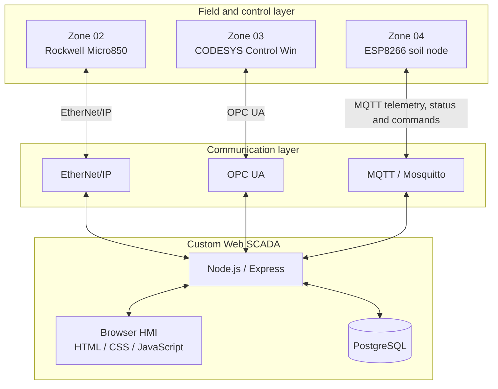

# Multi-Brand Custom Web SCADA

A custom browser-based SCADA/HMI for an industrial water-management testbed. The project brings together different controller and edge technologies behind one web monitoring interface.

The current implementation demonstrates three different zone integrations:

- **Zone 02 — Rockwell Micro850:** EtherNet/IP communication using a Node.js driver based on `st-ethernet-ip`.
- **Zone 03 — CODESYS:** OPC UA communication with a CODESYS Control Win runtime.
- **Zone 04 — IoT Edge:** ESP8266 telemetry and bidirectional mode commands over MQTT.

The web application uses **HTML, CSS and vanilla JavaScript** on the frontend, **Node.js and Express** on the backend, and **PostgreSQL** for equipment, tag configuration and historical readings.

This is an engineering testbed. It is intended to explore controller integration, protocol handling, data acquisition, operator interaction and IT/OT architecture. It is not presented as a production-ready or safety-certified control system.

## Project architecture



The backend acts as the integration layer between the controller-specific protocols and the browser HMI. The browser does not communicate directly with the PLCs.

## Zone implementation and status

| Zone | Technology | Integration | Current scope |
|---|---|---|---|
| Zone 02 | Rockwell Micro850 | EtherNet/IP | Live tag polling and whitelisted Boolean commands through the Node.js driver |
| Zone 03 | CODESYS Control Win | OPC UA | Live tag browsing and polling, operator commands and PLC-side process logic |
| Zone 04 | ESP8266 | MQTT | Soil-moisture telemetry, device status, AUTO/MANUAL commands and acknowledgements |
| SCADA | Custom Web HMI | REST API | Unified monitoring, zone cards, operator controls and communication status |

The project also contains local process simulations. In particular, Zone 04 moisture telemetry is received from the ESP8266, while its valve command and flow indication remain simulated. The ESP8266 firmware's onboard LED indicates the selected firmware mode; it is not physical valve feedback.

## Technology stack

| Layer | Technologies |
|---|---|
| Frontend | HTML5, CSS3, vanilla JavaScript |
| Backend | Node.js, Express |
| Database | PostgreSQL |
| Zone 02 protocol | EtherNet/IP |
| Zone 03 protocol | OPC UA |
| Zone 04 protocol | MQTT |
| MQTT broker | Mosquitto |
| Edge device | ESP8266 / Wemos D1 |
| PLC environments | Rockwell CCW / Micro800 and CODESYS |

## Key capabilities

- Multi-brand integration through separate protocol-specific backend drivers.
- Zone 02 Micro850 polling and controlled Boolean writes.
- Zone 03 OPC UA tag discovery from the CODESYS `GVL_SCADA` variable group.
- Zone 03 command whitelist, pulse handling for edge-triggered commands and server-side interlock messages.
- Zone 04 MQTT telemetry ingestion directly by the Node.js backend.
- MQTT device status and command-result acknowledgement handling.
- UDP broker discovery for the Zone 04 ESP8266 on a shared IPv4 subnet.
- PostgreSQL historian insertion for valid Zone 04 moisture readings.
- Live data freshness handling, including `GOOD` and `UNCERTAIN` quality states.
- REST endpoints that separate the browser HMI from industrial protocol details.

## Zone 02 — Rockwell Micro850

The Node.js driver is located at `server/drivers/micro800/zone02.js`.

- Uses the `st-ethernet-ip` library.
- Connects to the Micro850 using the configured PLC IP address.
- Polls configured Zone 02 tags at a one-second interval.
- Retries the connection after communication failure.
- Serializes PLC requests to avoid overlapping read and write operations.
- Uses a command whitelist. Start, Stop and Fault Reset are momentary pulse commands; Auto and Simulation Enable are level commands.
- Reads the permissive before accepting a Start command.

Default PLC address: `192.168.203.1`. Set `ZONE02_PLC_IP` to override it.

## Zone 03 — CODESYS and OPC UA

The backend connects to CODESYS Control Win through OPC UA at:

`opc.tcp://127.0.0.1:4840`

The OPC UA client browses the `GVL_SCADA` variable group and polls discovered variables every second. Zone 03 commands are restricted to a whitelist:

| HMI command | PLC variable | Handling |
|---|---|---|
| Start | `Z03_START` | 300 ms pulse |
| Stop | `Z03_STOP` | 300 ms pulse |
| Fault Reset | `Z03_FAULT_RESET` | 300 ms pulse |
| Auto | `Z03_AUTO` | Held TRUE |
| Manual | `Z03_AUTO` | Held FALSE |

The PLC remains responsible for process logic. The API mirrors relevant interlocks to return clear operator feedback.

## Zone 04 — MQTT and IoT Edge

The Zone 04 data path in the current SCADA implementation is:

```text
ESP8266 soil node
      |
      | MQTT telemetry
      v
Mosquitto broker
      |
      v
Node.js MQTT client (server/mqtt.js)
      |
      +----> Live Zone 04 state / REST API
      |
      +----> PostgreSQL tag_values historian
```

The ESP8266 publishes a moisture payload every 15 seconds to:

- Telemetry: `zone4/soil01/data`
- Device status: `zone4/soil01/status`
- Mode command: `zone4/soil01/command`
- Command result: `zone4/soil01/command_result`

The Node.js service validates incoming moisture values (0–100), updates the live value and asynchronously stores valid readings against the `Z04_MOISTURE` tag in PostgreSQL.

Historian quality records the validity at acquisition time. The live value can become `UNCERTAIN` when it exceeds the configured freshness threshold. The default threshold is 300 seconds and can be changed with `ZONE4_STALE_SECONDS`.

The HMI's AUTO/MANUAL mode changes are sent to the ESP8266 and require a command acknowledgement. START, STOP and RESET operate on the local Zone 04 process simulation; they do not actuate a physical valve.

### MQTT broker discovery

The SCADA backend listens for UDP discovery requests on port 1884 and advertises the MQTT broker's IPv4 address and TCP port (default 1883). The ESP8266 broadcasts after repeated MQTT connection failures and stores a discovered broker address in LittleFS.

Discovery is limited to a shared broadcast-enabled IPv4 subnet. It does not cross routers or VLAN boundaries.

## REST API

| Method | Endpoint | Purpose |
|---|---|---|
| GET | `/api` | API health response |
| GET | `/api/equipment` | Equipment configuration |
| GET | `/api/tags` | Tag configuration with equipment details |
| GET | `/api/tags/:tagName/value` | Latest stored value for a tag |
| GET | `/api/live` | Live CODESYS tag values |
| GET | `/api/zone02` | Zone 02 observations |
| POST | `/api/zone02/command` | Zone 02 whitelisted command |
| GET | `/api/zone3` | Zone 03 live values |
| POST | `/api/zone3/command` | Zone 03 whitelisted command |
| GET | `/api/zone4/live` | Latest in-memory MQTT reading and connection state |
| GET | `/api/zone4` | Latest stored Zone 04 moisture reading |
| GET | `/api/zone4/state` | Zone 04 supervisory process state |
| POST | `/api/zone4/command` | Zone 04 mode command or local simulation command |

## Repository structure

```text
index.html
css/                         HMI styles
js/                          Browser-side HMI logic
server/
  server.js                  Express API and service startup
  opcua.js                   CODESYS OPC UA client
  mqtt.js                    Zone 04 MQTT client and historian writes
  mqtt-discovery.js          UDP broker discovery responder
  zone04.js                  Zone 04 process simulation
  drivers/
    micro800/zone02.js       Rockwell Micro850 driver
database/                    PostgreSQL schema and database assets
PLC/                         PLC project assets
docs/                        Implementation notes and documentation
node-red/                    Node-RED flow assets retained in the repository
```

## Getting started

### Requirements

- Node.js and npm
- PostgreSQL
- Mosquitto MQTT broker
- CODESYS Control Win runtime with OPC UA enabled
- Rockwell Micro850 accessible over EtherNet/IP for Zone 02
- ESP8266 firmware and Wi-Fi configuration for Zone 04

### 1. Install dependencies

```bash
npm install
```

### 2. Configure PostgreSQL

Create the `building_irrigation` database and apply the SQL schema in `database/schema.sql`. Configure the database connection using the environment variables read by `server/database.js`.

### 3. Configure PLC and MQTT connections

Set the relevant environment variables before starting the service:

| Variable | Default | Purpose |
|---|---|---|
| `ZONE02_PLC_IP` | `192.168.203.1` | Micro850 address |
| `MQTT_URL` | `mqtt://localhost:1883` | MQTT broker URL |
| `MQTT_PORT` | `1883` | Broker port advertised by discovery |
| `MQTT_DISCOVERY_PORT` | `1884` | UDP discovery listener |
| `ZONE4_STALE_SECONDS` | `300` | Zone 04 live-data freshness threshold |

The CODESYS endpoint is currently defined in `server/opcua.js` as `opc.tcp://127.0.0.1:4840`.

### 4. Start the backend

```bash
npm start
```

The Express API listens on port 3000. The backend starts the Zone 02 driver, OPC UA client, MQTT client and UDP broker-discovery responder.

### 5. Open the HMI

Serve `index.html` through a local web server, such as the VS Code Live Server extension, and open it in a browser.

Check the API health endpoint at `http://localhost:3000/api`.

## Engineering limitations and security

This repository is a development and simulation testbed. Review these limitations before connecting real equipment:

- The current CODESYS OPC UA client uses SecurityPolicy None and an anonymous session.
- The Express API currently enables open CORS and does not implement operator authentication or authorization.
- MQTT is configured for an unauthenticated, unencrypted private LAN.
- UDP broker discovery is local-subnet broadcast discovery, not routed service discovery.
- Zone 04 valve and flow behavior is simulated; the ESP8266 LED is only a firmware mode indicator.
- Sensor calibration and physical field commissioning must be completed before treating moisture values as process-grade measurements.
- PLC interlocks in the API improve operator feedback but do not replace safety logic implemented and validated in the controller.
- Confirm network segmentation, access control, secure protocol configuration, fail-safe states and electrical protections before any production deployment.

## Related repositories

- [Wireless Irrigation Edge](https://github.com/Radfar/wireless-irrigation-edge) — ESP8266 firmware, RF irrigation controller and edge-device assets.
- [Water Process Integration Testbed](https://github.com/Radfar/water-process-integration-testbed) — broader testbed architecture.
- [OPC UA BACnet Gateway](https://github.com/Radfar/opcua-bacnet-gateway) — separate protocol gateway project.

## License

MIT. See [LICENSE](LICENSE).
