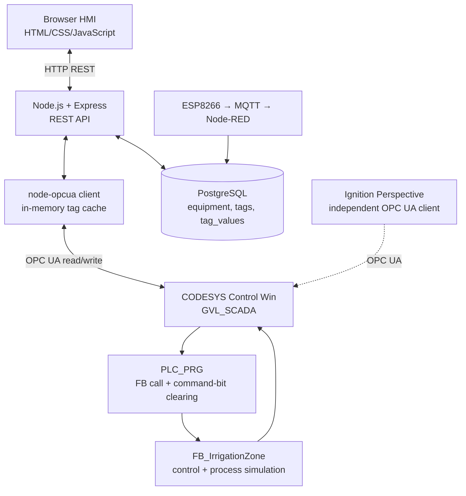
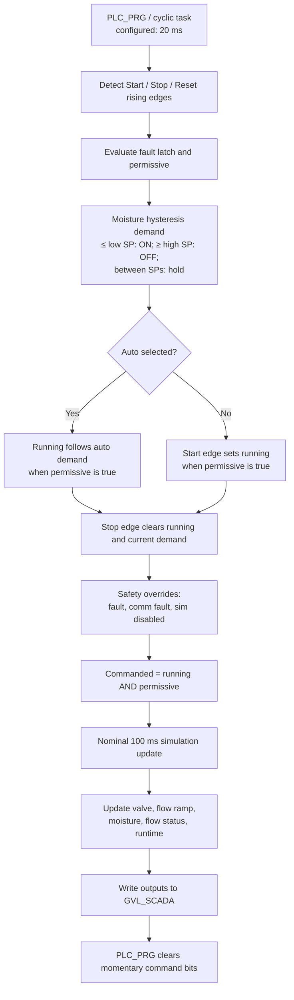
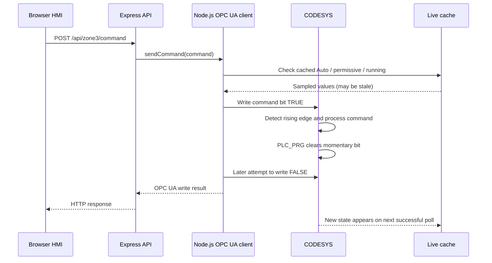

# Current Implementation — Workflow and Review

> Source-based review of the current repository and the CODESYS GVL_SCADA, FB_IrrigationZone, PLC_PRG, task settings, and Node.js OPC UA client supplied for review. No live runtime or end-to-end test was performed. This describes the testbed, not a production-ready control system.

## 1. System architecture

## 2. What is live versus simulated

| Area | Current implementation |
|---|---|
| Zone 03 values and commands | Live OPC UA path to CODESYS when runtime/session are available. The Zone 03 process itself is simulated in `FB_IrrigationZone`; no physical I/O mapping was present in the supplied program. |
| Zone 04 soil moisture | ESP8266 → MQTT → Node-RED → PostgreSQL → API. The pipeline is described as bench-tested, but the soil sensor is not yet wired/calibrated; values are not validated process measurements. |
| Tank, P-01 pump, header, Zones 01, 02, 05, 06 | Local HMI-side values in `js/tags.js`; no PLC I/O connection is currently documented. |
| Equipment and tag configuration | PostgreSQL. |
| Zone 03 history | README identifies an external `opcua-bacnet-gateway` as the history writer; this web service does not persist its own Zone 03 polling samples. |
| Ignition Perspective | Separate OPC UA client to the same CODESYS runtime. Command ownership/arbitration between clients is not documented. |

## 3. Zone 03 scan and simulation flow

### Configured timing

| Operation | Configured interval | Interpretation |
|---|---:|---|
| CODESYS cyclic task | 20 ms | 50 task cycles/s if runtime scheduling meets configuration. |
| FB process simulation | Nominal 100 ms | About 10 updates/s, subject to actual TON/runtime behavior. |
| Node.js OPC UA polling | 1,000 ms | About one poll/s; slower than internal simulation updates. |
| Node command pulse | 300 ms | Client requests this high interval, but PLC_PRG also clears the bit, so actual high duration is not guaranteed to be 300 ms. |

The simulation rates are applied per nominal simulation update; do not interpret them as per-second rates without converting the implementation.

## 4. Command path

| Command | PLC tag | Write style | Current server-side check |
|---|---|---|---|
| `start` | `Z03_START` | Pulse | Cached Auto must be false, permissive true, running false. |
| `stop` | `Z03_STOP` | Pulse | No server-side state gate. |
| `faultReset` | `Z03_FAULT_RESET` | Pulse | No server-side state gate; PLC clears latch only if simulated sensor and actuator faults are absent. |
| `auto` | `Z03_AUTO` | Write TRUE | No server-side state gate. |
| `manual` | `Z03_AUTO` | Write FALSE | No server-side state gate. |

A successful OPC UA write confirms write status; it does **not** confirm that the PLC accepted or completed the requested action.

## 5. Findings to resolve before redesign

Source inspection only; these have not been runtime-tested.

| Priority | Finding | Implication |
|---|---|---|
| High | **Stop is not persistent in Auto.** Stop clears current demand, but the hysteresis logic can reassert demand on a later scan when moisture remains at/below the low setpoint. If Auto and permissive remain active, the zone can restart. | Specify whether Stop means momentary stop, Auto inhibit/hold, mode change, or latched operator stop; then implement and test that behavior. |
| High | No command ID, PLC accepted/rejected acknowledgement, completion feedback, timeout, or command audit record in the supplied command path. | Separate request, acceptance, execution, rejection, timeout, and connection-loss states. |
| High | Pulse commands are not serialized. Concurrent requests can interfere when one request writes FALSE while another pulse is active. | Serialize commands or implement a PLC-side handshake/sequence mechanism. |
| High | OPC UA uses `MessageSecurityMode.None`, `SecurityPolicy.None`, and anonymous access; README identifies open CORS and no API authentication. | Local test configuration only. Define identity, authorization, secure communications, network segmentation, and controlled remote access before real equipment. |
| Medium | Start interlocks use a cache sampled nominally once per second and may be stale. | PLC-side interlocks remain authoritative; report freshness and quality. |
| Medium | A successful batch read marks the connection connected even if individual tag status codes are bad. Per-tag quality/timestamps are not retained. | Separate session health from tag quality/freshness. |
| Medium | Async `setInterval` polls can overlap if a read exceeds the interval. | Use a non-overlapping poll loop with timeout/error handling. |
| Medium | No automatic OPC UA reconnect/session recreation in the reviewed client. | Add and test reconnect, backoff, cache invalidation, and recovery. |
| Medium | `Z03_RUN_FEEDBACK` mirrors internal running state; it is not independent physical feedback. Low-flow is diagnostic only. | Distinguish command, controller state, physical feedback, and trip/alarm policy. |
| Medium | Simulation time bases and TON behavior need runtime verification. | Document units/time bases and test actual timing. |
| Medium | Node.js and Ignition can access the same PLC; command authority/arbitration is undocumented. | Define source ownership, command permissions, and auditability. |

**Conclusion:** This is a useful integration testbed, but it should not be described as production-ready, as having verified command completion, as having physical feedback, or as having a Stop command that always wins in Auto.

## 6. Principles for the future design

These are proposed design principles, not current capabilities.

1. **Local control remains autonomous.** Essential control, permissives, interlocks, and defined safe-state behavior run in the PLC/controller, not in a browser, cloud, database, historian, or SMS service.
2. **SCADA is supervisory.** The HMI requests a command; the controller evaluates it and reports acceptance and resulting state.
3. **Separate command from feedback.** Track requested command, controller acceptance, controller state, physical feedback where available, and alarm/fault state separately.
4. **Define Auto/Manual and Stop semantics.** Include restart conditions, fault reset, and behavior after communication loss.
5. **SMS is optional, not a control dependency.** If retained, route SMS commands through an authenticated command service with sender/user allowlisting, validation, expiry/anti-replay controls where feasible, audit logging, acknowledgement, and the same PLC interlocks. SMS must not bypass local/controller protections.
6. **Expose data quality.** Include quality, source timestamp, freshness, and connection state. Distinguish live PLC data, stored telemetry, simulated data, and stale/unavailable data.
7. **Secure the OT boundary.** Define network zones, least privilege, authenticated API access, secure OPC UA configuration, and controlled remote access.
8. **Normalize tags at the integration boundary.** Define stable equipment IDs, names, types, units, quality, timestamps, read/write permissions, and command semantics independent of PLC vendor.
9. **Choose units explicitly.** A North American operator HMI may use US gpm for flow, %, psi, °F, Hz, V, and A as appropriate. Keep current PLC units internally until a documented conversion boundary exists.
10. **Verify before claiming production readiness.** Test command races, Stop-in-Auto, interlocks, sensor/communication faults, reconnect, stale data, multiple clients, and restart/recovery.

## 7. Next phase

Before redesign, agree on the meaning of **Stop while Auto is selected**, then define command acknowledgement, authority across the web HMI and Ignition, tag quality/freshness, security boundaries, and the test cases that prove the requirements.
