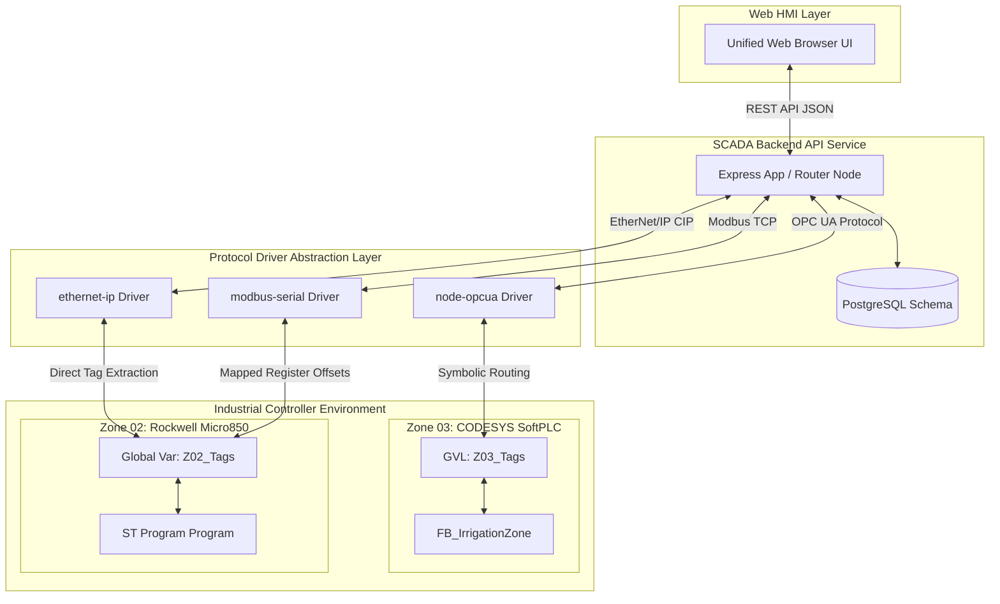

## 🔌 Multi-Brand PLC Driver Architecture & Integration Contract

This project implements a vendor-agnostic architecture layer designed to decouple the SCADA HMI backend from individual hardware manufacturers. By adhering to a unified tag and behavioral contract, you can deploy distinct PLC brands (CODESYS, Rockwell Automation Micro850, Siemens S7, or Modbus TCP modules) across different irrigation zones without rewriting any Node.js service routes or database schemas.

### Core Interface Abstraction Architecture

### Multi-Brand PLC Implementation Compliance Checklist

When adding a new controller node to the irrigation grid, the PLC program must satisfy these criteria:

1. **Tag Mapping:** Expose global control variables matching the standard `ZX_[Tag]` format exactly (where `X` represents the integer Zone number).
2. **Internal Scoping:** Isolate processing variables (`R_TRIG` blocks, `TON` elements, calculation steps) entirely inside the program local scope, keeping the global memory space clean.
3. **Unconditional Simulation Loops:** If using simulation profiles, execute tracking clocks (e.g., `SimTick`) unconditionally every scan cycle to ensure calculation loops update reliably.
4. **Command Autoclear:** Momentary SCADA input variables (`START`, `STOP`, `FAULT_RESET`) must be consumed by internal program edge triggers and cleared immediately back to `FALSE` inside the same execution pass to prevent protocol write locking.
